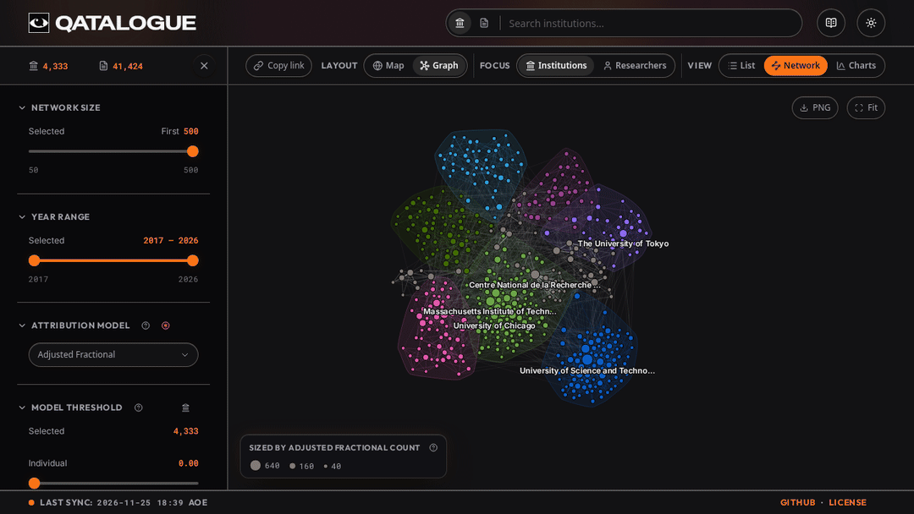

# Qatalogue

Bibliometric explorer for Quantum Information Science and Technology (QIST) ([qatalogue.org](https://qatalogue.org)). Reads OpenAlex, ROR, and arXiv metadata according to `pipeline/config/scope.json` and writes the served SQLite database (`data/serve.db`).



## Features

- **Lists:** Institutions and researchers sorted by name, affiliation/location, or score, with expandable faculty and paper rows linking to ORCID, OpenAlex, and DOIs.
- **Attribution models:** *Adjusted Fractional*, *Fractional*, *Total*, and *None*, with individual, institutional, and average thresholds.
- **Network:** Force-directed and world-map co-authorship/institutional graphs with PNG export.
- **Charts:** Cross-tabulations, time trends, histograms, scatter plots, and heat grids with evidence tables and PNG/CSV export.
- **Paper search:** Title, abstract, keyword, and concept search using `Xenova/bge-small-en-v1.5` embeddings and SQLite FTS5.
- **Filters & URLs:** Topics, subtopics, hardware platforms, venues, years, regions, and locations, encoded as short query links.

## Tech Stack

- **Frontend:** React 19, TypeScript, Tailwind CSS v4, Vite, D3, Graphology
- **Server:** Express, `better-sqlite3`, `@huggingface/transformers`
- **Pipeline:** Python 3.12 (`.python-version`), Node 22 (`.nvmrc`), Polars, NetworkX, SQLite

## Getting Started

The repository contains no built data or API keys. Set `POLITE_POOL_EMAIL` in `.env` (and an OpenAlex key for large scopes):

```bash
make setup    # creates .venv from pipeline/requirements.lock, installs npm packages, copies .env.example
# edit .env: set POLITE_POOL_EMAIL (and OPENALEX_API_KEY_ENABLED=true + OPENALEX_API_KEY if needed)
make all      # fetch, enrich, embed, classify, merge, check, and publish data/serve.db
npm run dev   # development server on http://localhost:3000
```

### Scope

| File | Coverage | Notes |
|---|---|---|
| [`pipeline/config/scope.json`](pipeline/config/scope.json) *(default)* | 16 venues, `2017–2026` | ~40,000 papers; needs an OpenAlex key (~2 h cold build across API enrichment, ROR geocoding, and ~30 min CPU embedding; longer with Springer Nature; resumable) |
| [`pipeline/config/scope.example.json`](pipeline/config/scope.example.json) | 2 venues (`PRX Quantum`, `Quantum`), `2024–2025` | ~1,200 papers; builds in minutes |
| `pipeline/config/scope.local.json` | Copy of either file | Custom years, venues (`S…`), and corpus topics (`T…`) |

Run another scope with `SCOPE_PATH`:

```bash
SCOPE_PATH=pipeline/config/scope.example.json make all
```

`make all` fetches only missing `(venue, year)` shards and rebuilds decisions into `data/`. Run `make archive` first when replacing an existing build. Counts vary across runs because OpenAlex records change upstream.

## Commands

Run `make` alone to list targets.

| Command | Purpose |
|---|---|
| `make setup` | Create `.venv`, install dependencies, create `.env` |
| `make all` | Run full data pipeline, check staged DB, and swap live |
| `make check` | Validate staged build (`CHECK_ARGS=--allow-shrink` when narrowing scope) |
| `make dev` | Start development server with Vite HMR |
| `make build` / `make start` | Build `dist/` (`dist/client/` + `dist/server.cjs`) and run production server |
| `make clean` | Remove `dist/` |
| `make test` | Run TypeScript (`npm test`) and Python (`tests/pipeline`) suites |
| `make lint` | Run `tsc --noEmit` and `pyflakes pipeline tests/pipeline` |
| `make archive` | Move built DBs, `public/default-*.json.gz`, and `logs/` to `../<project>-archive/<timestamp>/` (`ARGS="--dry-run \| --keep-cache \| --yes"`) |

## Containers

Use rootless Podman (or `--user "$(id -u):$(id -g)"` with Docker on Linux); drop `:z` on non-SELinux hosts.

```bash
cp .env.example .env
podman build --target pipeline -t qatalogue-pipeline .

# Small scope: add -e SCOPE_PATH=pipeline/config/scope.example.json
podman run --rm -it -v "$PWD":/app:z -v qatalogue-node-modules:/app/node_modules -v qatalogue-venv:/app/.venv qatalogue-pipeline make all

# Development server at http://localhost:3000
podman run --rm -it -p 3000:3000 -p 24678:24678 -v "$PWD":/app:z -v qatalogue-node-modules:/app/node_modules -v qatalogue-venv:/app/.venv qatalogue-pipeline make dev
```

After changes to `package-lock.json` or `pipeline/requirements.lock`, remove the dependency volumes (`podman volume rm qatalogue-node-modules qatalogue-venv`).

### Production & Compose

The default [`Dockerfile`](Dockerfile) target runs Node 22 as non-root with `data/` and `public/` mounted read-only:

```bash
podman build -t qatalogue .   # pass --build-arg SITE_URL=https://... if needed
podman run -d --name qatalogue -p 3000:3000 \
  -v "$PWD/data":/app/data:ro,z \
  -v "$PWD/public":/app/public:ro,z \
  qatalogue
```

With [`compose.yml`](compose.yml):

```bash
podman compose run --rm pipeline make all
podman compose up -d web
```

## Methodology

- **Scope & ingestion:** [`pipeline/config/scope.json`](pipeline/config/scope.json), [`pipeline/scripts/import.py`](pipeline/scripts/import.py), [`pipeline/scripts/enrich_papers.py`](pipeline/scripts/enrich_papers.py)
- **Article-type filtering:** [`pipeline/scripts/fetch_article_types.py`](pipeline/scripts/fetch_article_types.py), [`pipeline/scripts/classify_articles.py`](pipeline/scripts/classify_articles.py)
- **Topic & platform assignment:** [`data/taxonomy.json`](data/taxonomy.json), [`pipeline/scripts/assign_topics.py`](pipeline/scripts/assign_topics.py), [`pipeline/topics/classifier.py`](pipeline/topics/classifier.py)
- **Author & institution merging:** [`pipeline/scripts/merge_entities.py`](pipeline/scripts/merge_entities.py), `pipeline/stages/`
- **Credit attribution & summaries:** [`pipeline/core/credit.py`](pipeline/core/credit.py), [`pipeline/scripts/build_canonical_facts.py`](pipeline/scripts/build_canonical_facts.py), [`pipeline/scripts/build_performance_summary.py`](pipeline/scripts/build_performance_summary.py)
- **Locations, coordinates & search index:** [`shared/locationNames.ts`](shared/locationNames.ts), [`pipeline/scripts/build_geo.py`](pipeline/scripts/build_geo.py), [`pipeline/scripts/embed_papers.mjs`](pipeline/scripts/embed_papers.mjs), [`pipeline/scripts/build_search_index.py`](pipeline/scripts/build_search_index.py)

## Contributing

Run `make test`, `make lint`, and `npm run link-codes -- --check`.

## License

- **Code:** [MIT License](LICENSE)
- **Data & generated site content:** [CC BY 4.0](LICENSE-DATA.md) (lists, scores, networks, charts, taxonomy, methodology text; OpenAlex/ROR sources are CC0)
- **Logo & favicon:** `public/qatalogue.svg` and `public/favicon.ico` are all rights reserved.

## Author & Contact

Built by [Shadnan Azwad Khan](https://orcid.org/0000-0003-2769-6856). For general inquiries, private data corrections, or profile suppression requests, email [contact@qatalogue.org](mailto:contact@qatalogue.org).
